# 新規事業開発サービスページ 企画書

v0.3 / 2026/10/22

変更点（v0.2→v0.3）：1枚目のゴールを「30分の無料相談、またはお問い合わせ」にした。2枚目は社数をやめ、各タイプの中身と代表企業を見せる形にした。15・16枚目（つくり方・進め方の型）を削除。

- 目的：サービスページの「誰に・何を・どう見せるか」を社内で合意する
- 読み手：JIL社内（役員・メンバー）
- 枚数の目安：14枚

---

## 1. 誰に向けたページか

**リード**：大企業の新規事業部門の担当者・責任者

- 社内の審査や上司に、依頼先を説明する立場
- 悩み：事業計画が審査を通らない／つくれる人がいない／リリース後の人手が足りない
- ゴール：30分の無料相談、またはお問い合わせ

---

## 2. 競合の捉え方

**リード**：競合は4つのタイプに分かれる

| タイプ | どういう会社か | 主な企業 |
|---|---|---|
| 新規事業コンサル | 大企業の新規事業を、構想と検証から伴走する | アルファドライブ／Relic／quantum／ボーンレックス／ユニコーンファーム ほか |
| AI×事業開発 | AIの開発力を軸に、事業づくりや業務を変える | Algomatic／Sun*／AVILEN／エクサウィザーズ／リブ・コンサルティング ほか |
| 実行の伴走支援 | 立ち上げ後の営業・マーケ・業務を、実行まで担う | Zingth／才流／セレブリックス／SALES ROBOTICS／Acrosstudio ほか |
| 海外の事業スタジオ | 事業を一緒につくり、市場で試すところまで担う | Bundl／IDEO／BCG X／Board of Innovation／Rainmaking ほか |

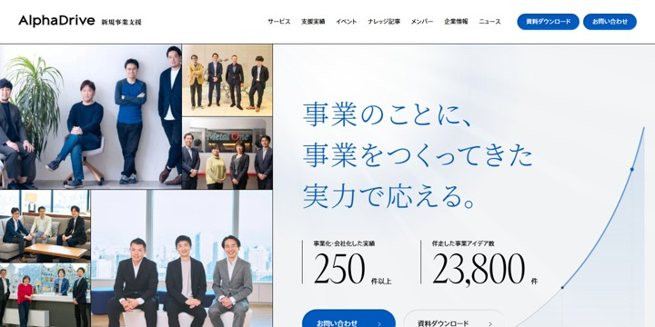（アルファドライブ／Algomatic／Zingth／Bundl の最初の画面を並べる）

※各タイプ10社・計39社を調査（アルファドライブは2タイプに該当）。画面は2026/10/16・19 撮影

---

## 3. 業界の「当たり前」

**リード**：どの会社も「一気通貫・伴走」を掲げている

- 実際は工程ごとに得意な会社が分かれている
- 依頼する側は会社を分けて頼むことになり、つなぎ目で止まりやすい

（図のイメージ）
```
 戦略          開発                  実行
 コンサル  →   開発会社・AIベンダー  →  営業・マーケ会社
          ↑ 止まりやすい        ↑ 止まりやすい
```

---

## 4. JILの立ち位置

**リード**：戦略・開発・実行を、ひとつのチームで受ける

- 描いて終わり、つくって終わりにしない
- ページでは3つの円の図で見せる（他社との比較表は使わない）

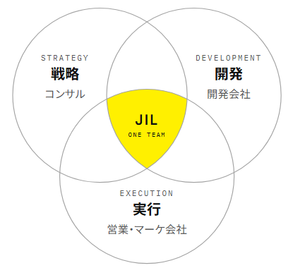

---

## 5. 訴求ポイント

**リード**：打ち出すのは「審査する側の目」と「人材まで」

| 他社もよく言うこと | JILの打ち出し | 根拠 |
|---|---|---|
| 実践者が支援 | 審査する側の目で見極める | 役員の事業審査 年1,500件超 |
| 開発まで対応 | 本番のプロダクトまでつくる | 新規サービスの立ち上げ 年10件以上 |
| 伴走 | 売る人・回す人までアサイン | 常駐・業務委託で参加 |
| AIを活用 | AIは前に出さず、全工程で使う | 工程ごとの活用例 |

---

## 6. ページ全体の構成

**リード**：6つの欄で構成

1. 最初の画面：キャッチとロゴ
2. コンセプト：JILの立ち位置
3. 特徴：見極める・つくる・動かす
4. 事業づくりの流れ：支援の範囲
5. 事業開発×AI：進め方
6. ご相談：30分の無料相談

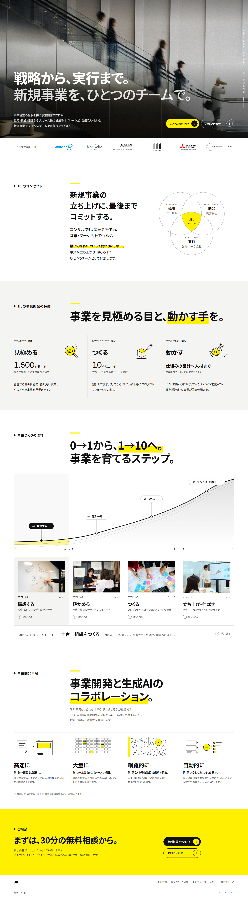

---

## 7. 入れなかったもの

**リード**：同業の定番は使わない

| 使わないもの | 代わりに |
|---|---|
| 「お悩みありませんか」の箱 | 流れの各ステップで答える |
| 他社との比較表 | 3つの円の図 |
| 実績数字の帯 | ロゴと役員の経験の数字 |
| 顔写真・料金 | 相談の場で説明 |

- お客様インタビュー（5社）は取材後に追加

---

## 8. 最初の画面

**リード**：戦略から、実行まで。新規事業を、ひとつのチームで。

- 写真はエスカレーターを行き交う人
- ご支援企業6社のロゴをすぐ下に
- ボタンは「30分の無料相談」と「お問い合わせ」

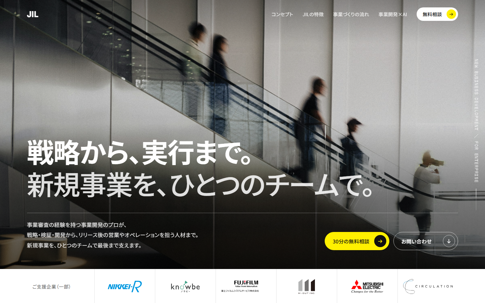

---

## 9. JILの特徴

**リード**：見極める・つくる・動かす

- 見極める：1,500件超／年（役員が携わってきた事業審査）
- つくる：10件以上／年（立ち上げてきた新規サービス）
- 動かす：人材まで（仕組みづくりと人材のアサイン）
- 数字は会社の実績ではなく、役員の経験として出す

---

## 10. 事業づくりの流れ

**リード**：4つのステップと土台で、立ち上げ全体を支援

- 構想する → 確かめる → つくる → 立ち上げ・伸ばす
- 土台は組織づくり（起案制度・カルチャー・研修）
- どのステップからでも依頼できる

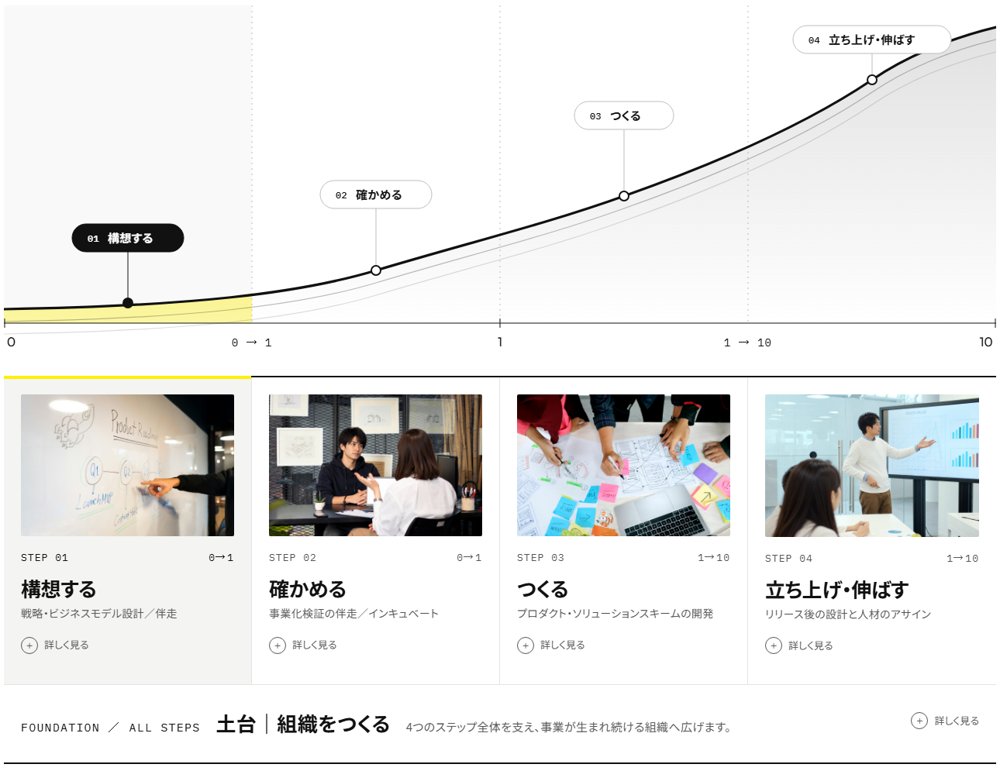

---

## 11. 事業開発×AI

**リード**：AIは前に出さず、進め方として見せる

- キャッチには入れず、ページの後半で「進め方」として紹介する
- 同業はAIを新メニューとして足す形が多い
- 高速に：例）試作画面を翌日に
- 大量に：例）LP・広告を50パターンで検証
- 網羅的に：例）競合・市場を数百社規模で調査
- 自動的に：例）問い合わせ対応を自動で

（図はページのAI欄の4つの線画を使う）

※例は支援内容の一例。期間や数量は案件によって異なる

---

## 12. デザイン調査

**リード**：同業の半分は「白×青」

- 同業24社と、デザインの評価が高いサイト30件を撮影して比較
- 白×青は24社中12社。AI系はぼかしや球体の表現が多い
- JILは白と黒を基本に、図を主役にする

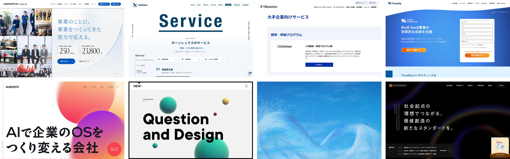

出典：各社サイト（2026/10/16・19 撮影）

---

## 13. 手本にした4サイト

**リード**：手本はBundl・Hexa・Coral Capital・PKSHA

| サイト | 参考にしたところ |
|---|---|
| Bundl | 文字と余白で見せる |
| Hexa | 0→1→10を線画で |
| Coral Capital | 3つの柱を重なる円で |
| PKSHA | 白黒の静かなトーン |

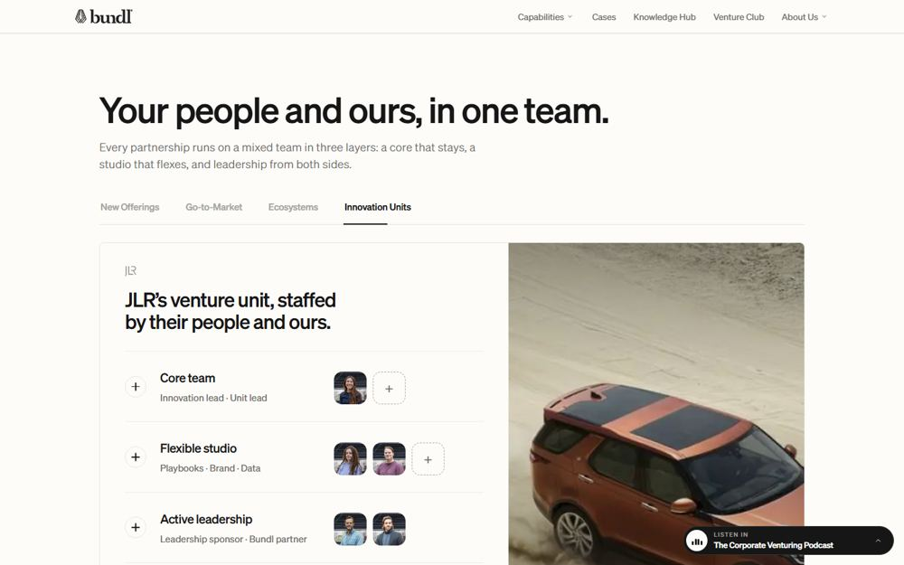
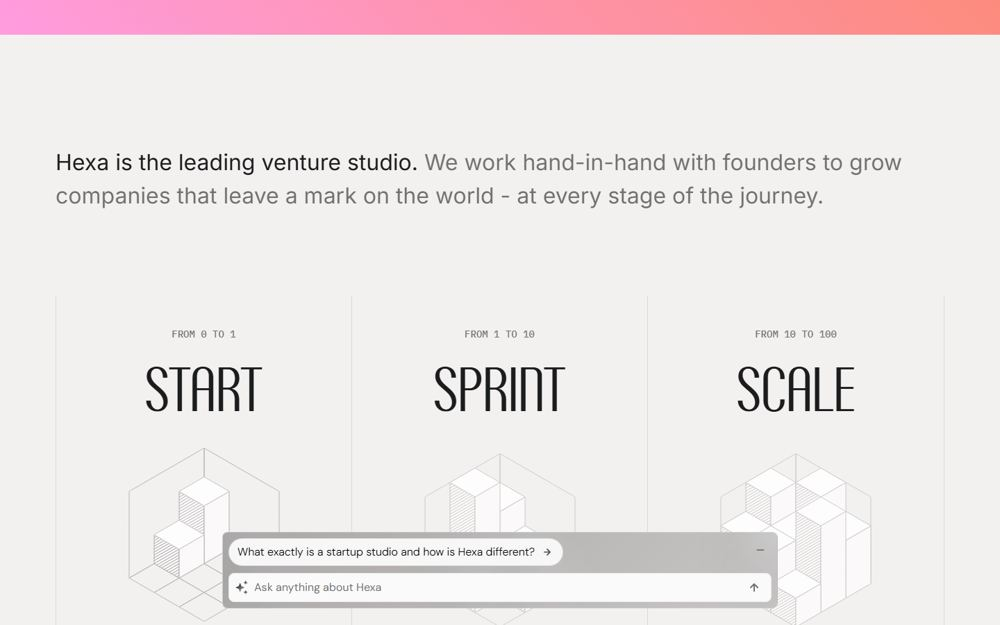
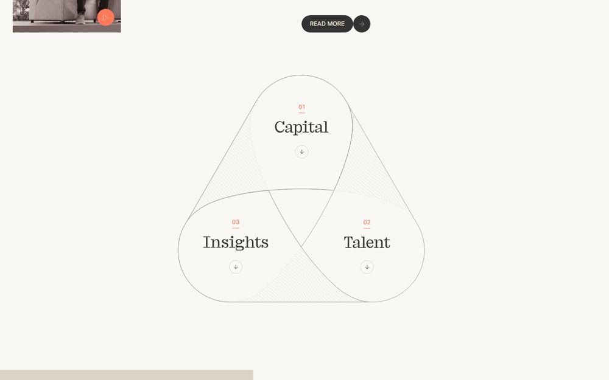
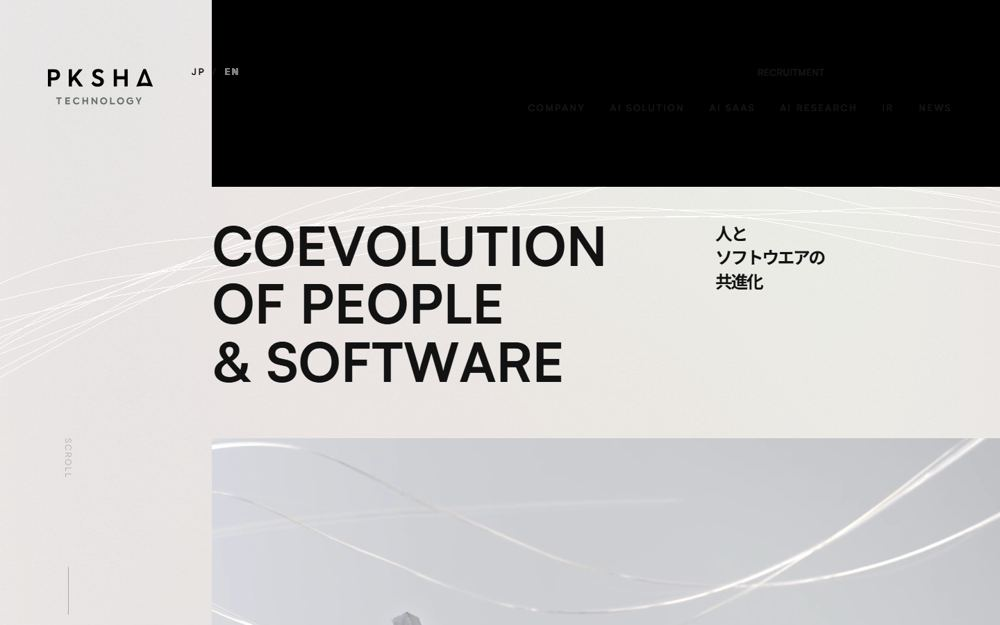

出典：bundl.com／hexa.com／coralcap.co／pkshatech.com（2026/10/19 撮影）

---

## 14. デザインの方針

**リード**：白と黒に、黄色をひとつ

- 黄色は強調とボタンだけに使う
- 写真は人が働く場面
- 図は線で描く
- スマホでも同じ内容

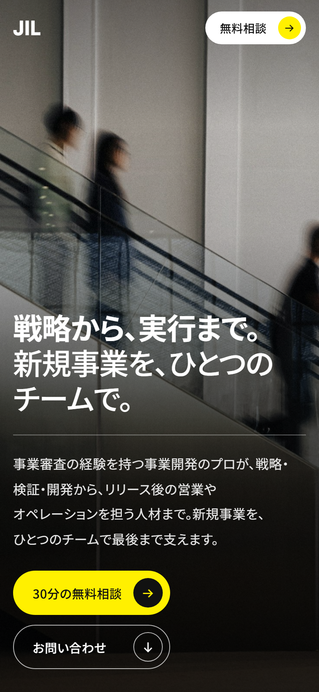
