# コーポレートサイト リニューアル企画書

v0.3 / 2026/10/29

変更点（v0.2→v0.3）：サイトのメニュー変更（「事業」をなくし「プロダクト」と「サービス」に分けた）に合わせて、10枚目のサイトツリーと13枚目の導線を更新。14枚目にスマホの改行の対応を追加。サイトの画面の画像を撮り直した。

- 目的：新しいコーポレートサイトを「なぜこの形にしたか」まで含めて経営陣に説明し、公開の合意をとる
- 読み手：JIL経営陣（制作チームが外部の制作会社の立場で報告する）
- 枚数の目安：14枚

---

## 1. 今のサイトの課題

**リード**：会社の顔つきが見えにくい今のサイト

- 最初の画面は英字の標語と商品写真。何の会社か読み取りにくい
- 載っている事業は2つ。すでに提供中の採用支援が載っていない
- 働く人・組織の様子が伝わらない

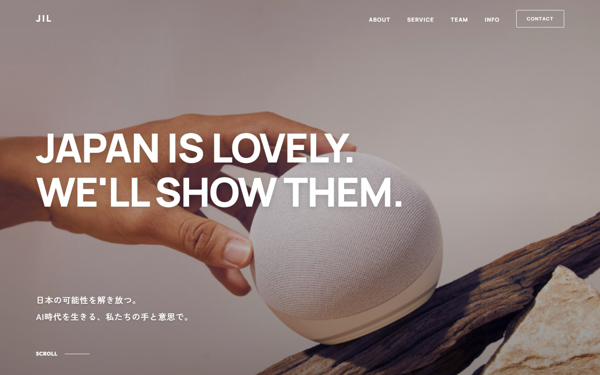

出典：https://jilinc.co.jp/ （2026/10/23 撮影）

---

## 2. リニューアルの目標

**リード**：「人が中心の、AIで動く会社」が伝わるサイトへ

- ひと目で「何の会社か」がわかる
- 3つの事業（プロダクト／新規事業開発支援／採用支援）がそろって見える
- 読んだ人が迷わず、お問い合わせまでたどり着ける

| 主な読み手 | 知りたいこと |
|---|---|
| 発注を考える企業 | 何を頼めるか、任せて大丈夫か |
| 一緒に働きたい人 | どんな考え方・どんな人の会社か |
| 取引先・関係者 | 会社の概要、役員 |

---

## 3. 伝えたいことの整理

**リード**：中心に人、周りにAI、外側に3つの事業

- 中心：事業をつくる「人」の会社
- その周り：組織のあらゆる仕事にAIを使う（AIドリブン）
- 外側：人とAIの力を、3つの事業に
- 3つの事業は互いに知見を返し合う

（図のイメージ）
```
          プロダクト
             ●
        ／  AI  ＼
       ( ( 人 ) )
        ＼      ／
  新規事業開発支援 ●   ● 採用支援
```

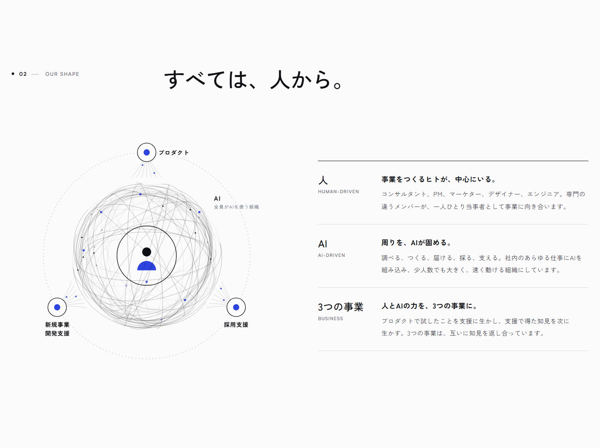

---

## 4. 言葉の整理

**リード**：今のサイトの言葉を受け継ぎ、新しい言葉を足す

| 場所 | 言葉 |
|---|---|
| 最初の画面 | 日本の可能性を、解き放つ。／AI時代を生きる、私たちの手と意思で。 |
| 会社の一言 | JILは、事業をつくる会社です。 |
| 私たちについて | 日本の現場力と、AIの進化。そのあいだを、人で繋ぐ。 |
| 会社の構造 | すべては、人から。 |
| 人とAI | AIが手を増やし、人が意思を磨く。 |

- 「JAPAN IS LOVELY.」は社名の由来として残し、フッターに大きく置く

---

## 5. 参考サイトの調査

**リード**：国内外40社のコーポレートサイトを比較

| 分野 | 社数 | 主な企業 |
|---|---|---|
| AI企業（国内） | 7 | PKSHA／Algomatic／LayerX／Sakana AI ほか |
| AI企業（海外） | 6 | Anthropic／Cohere／Mistral ほか |
| スタートアップ | 8 | SmartHR／10X／Ubie／UPSIDER ほか |
| 制作・ブランディング（国内） | 8 | Takram／Goodpatch／BASSDRUM ほか |
| 制作・ブランディング（海外） | 5 | Pentagram／Instrument ほか |
| ITコンサル・人材・組織 | 6 | Ridgelinez／Sun*／MIMIGURI ほか |

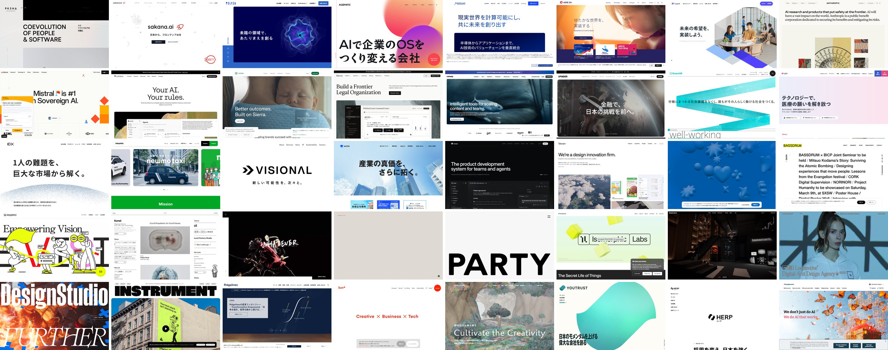

出典：各社サイト（2026/10/23 撮影）

---

## 6. 手本の選び方

**リード**：決め手は「人の集まりに見えるか」

- 好き：PKSHA／Algomatic／LayerX／SmartHR
- 外した理由の例

| 外した理由 | 例 |
|---|---|
| 商品紹介のページに見える | ELYZA／PFN／Sakana AI |
| 製品が主役すぎる | Harvey／10X |
| 外資っぽい | Anthropic／Mistral／Runway |
| 暗い・素っ気ない | Linear／Visional |

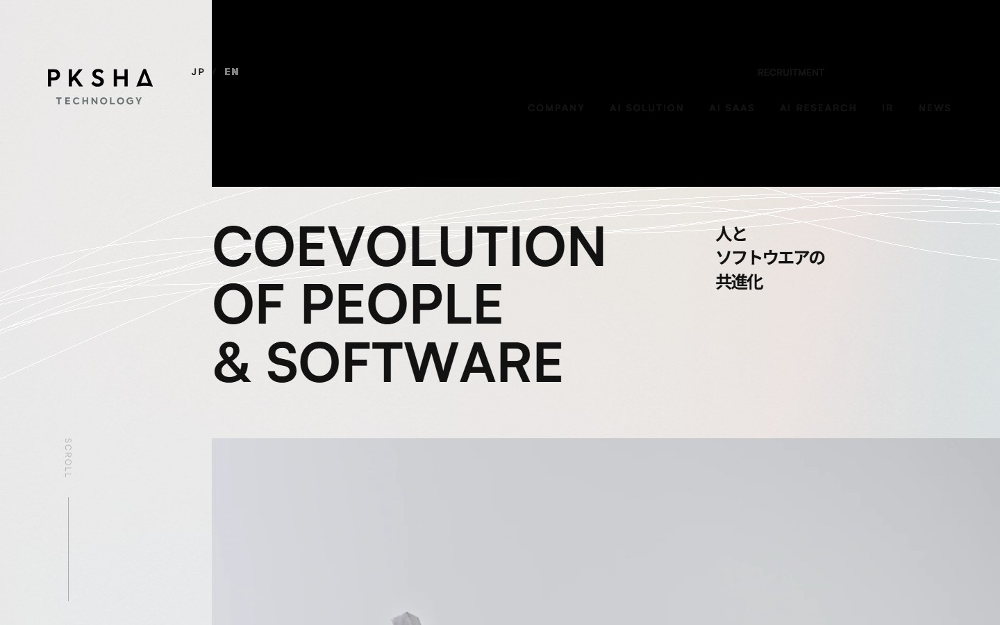
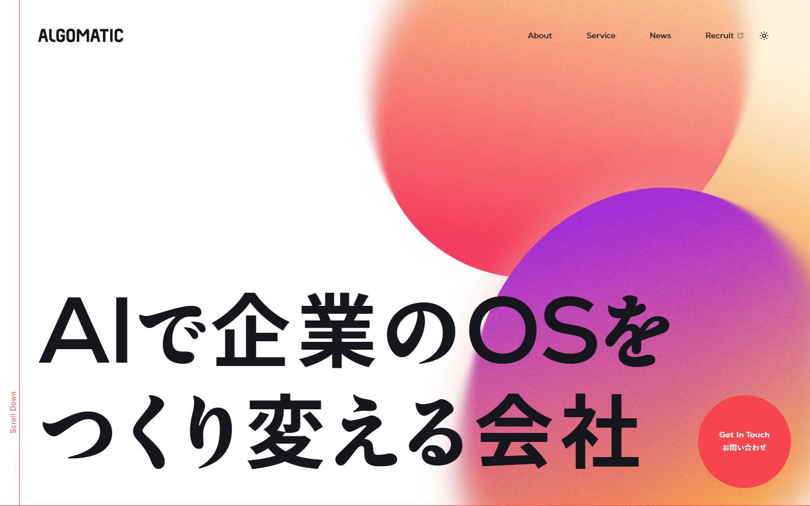
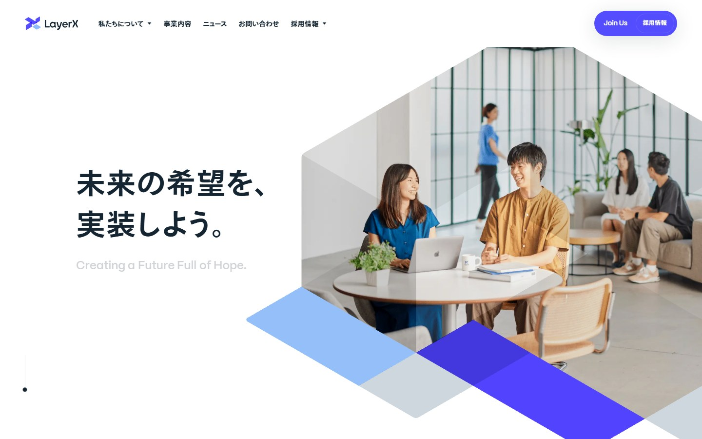
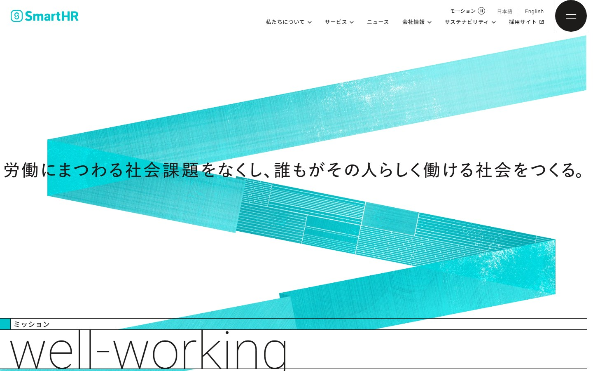

出典：pkshatech.com／algomatic.jp／layerx.co.jp／smarthr.co.jp（2026/10/23 撮影）

---

## 7. 手本4社の共通点

**リード**：4社に共通する6つの型と、JILでの取り入れ方

| 4社の共通点 | JILでの取り入れ方 |
|---|---|
| 会社を言い切る一文 | 日本の可能性を、解き放つ。 |
| 会社ならではのモチーフ | 水面に落ちる一滴（意思が広がる） |
| 中心から広がる構造図 | 人 → AI → 3つの事業の図 |
| 厚い「私たちについて」 | 独立したページに（ミッション〜会社概要） |
| 明るい地に、ブランド色を1色 | 白と墨に、青をひとつ |
| 条件をそろえた社員写真 | 撮影は役員3名のみ。組織感は図と言葉で出す |

---

## 8. 検討の経緯

**リード**：試作を見比べ、引き算で決めた

| 検討したこと | 試した案 | 決めたこと |
|---|---|---|
| 最初の画面 | 波紋の図／点の集まり／人の写真 | 本物の水面に一滴が落ちる動き |
| 人の表し方 | 写真／指紋／筆文字／シルエット／アイコン6種 | 2色の人のアイコン |
| 人とAIの図 | 掛け算の帯／2つの円の重なり | 円の重なり（透けて見える形） |
| 色 | 青×橙／青×黄／青紫×桃 | 青ひとつ。色は下層ページの冒頭で足す |
| 写真 | 夜景／工場／職人の手 など | 人が写る写真（交差点・頂上の人たち） |

- 24回の改版。毎回、画面を撮って手本と並べて確認

---

## 9. デザインの方針

**リード**：白と墨に、青をひとつ

- 地は明るい白、文字は墨。青は強調と「人」の印だけ
- 動きは最初の画面の水面と、図ができあがる動きに絞る
- 写真は「人が写るもの」だけ
- 英字はSatoshi、日本語はZen Kaku Gothic New

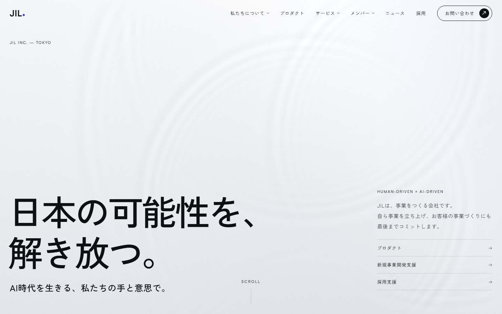

---

## 10. サイトツリー

**リード**：トップ＋5ページ＋専用サイト1つ

（図のイメージ）
```
トップ
├─ 私たちについて   ミッション・ビジョン／行動指針／スタイル／会社概要
├─ プロダクト
├─ サービス（押せない見出し。開くと下の2つ）
│   ├─ 新規事業開発支援 ──→ 専用サイト（サービスページ）
│   └─ 採用支援
├─ メンバー          ボードメンバー／チームメンバー
├─ ニュース（トップ内）
└─ お問い合わせ ──→ お問い合わせフォーム（採用・事業）
```

- メニューは「プロダクト」と「サービス」に分け、自社のプロダクトとお客様向けのサービスを見分けやすくした
- ページの住所は今の会社サイトと同じ形（/about/、/product/ など）

---

## 11. トップページの流れ

**リード**：上から読むと「JILとは何か」がわかる順番

| 順番 | 欄 | 役割 |
|---|---|---|
| 1 | 最初の画面 | 何の会社かを一言で |
| 2 | 私たちについて | 想いと、やっていること |
| 3 | 会社の構造 | 人 → AI → 3つの事業 |
| 4 | 3つの事業 | 各事業ページへの入口 |
| 5 | 人とAI | 働き方の考え方 |
| 6 | JILをつくる人たち | 役員3名 |
| 7 | ニュース | 会社の動き |
| 8 | お問い合わせ | 採用・事業の2つの出口 |

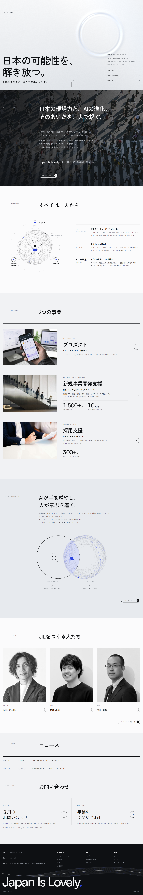

---

## 12. 各ページの役割

**リード**：下層ページは同じ型で、役割を分ける

| ページ | 役割 | 主な中身 |
|---|---|---|
| 私たちについて | 考え方を伝える | 社名の由来／ミッション・ビジョン／行動指針／スタイル／会社概要 |
| プロダクト | 自分たちでつくっている証拠 | 4つのプロダクト／自社でつくる理由 |
| 新規事業開発支援 | 強みだけ見せ、専用サイトへ | 見極める・つくる・動かす |
| 採用支援 | 専用サイトがないので、ここで全部 | 考え方／よくあるお悩み／支援の流れ6工程／FAQ |
| メンバー | 人の顔が見える | 役員3名／チームの職種 |

- 冒頭は共通の型：大きな英字の見出し（About. など）＋線の背景

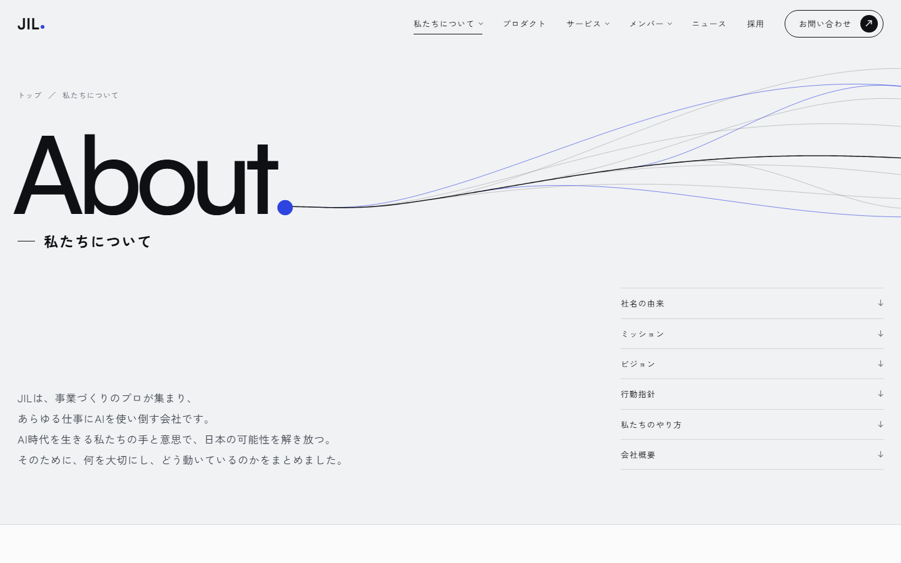

---

## 13. 導線の設計

**リード**：どのページからも、次の行き先がある

- 全ページ共通のメニュー。中の欄まで直接行ける
- 下層ページの最後に「次のページへ」。5ページを一周
- お問い合わせは、どこからでも1回押せばフォームへ

| 読み手 | たどる道 |
|---|---|
| 発注を考える企業 | トップ → サービス → 新規事業開発支援 → 専用サイト → 相談 |
| 一緒に働きたい人 | トップ → 私たちについて → メンバー → 採用のお問い合わせ |
| 取引先・関係者 | トップ → 私たちについて → 会社概要 |

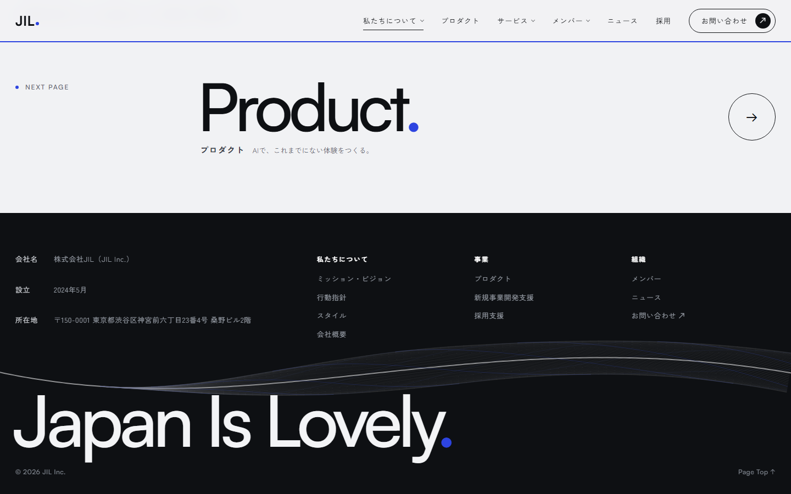

---

## 14. スマホと使いやすさ

**リード**：スマホでも、同じ内容を同じ質で

- メニュー：どの位置からでも開く、全画面のメニュー
- 速さ：書体を共通化し、写真を圧縮して表示を軽く
- 読みやすさ：iPhoneでも言葉の途中で改行しない。補足の文字の濃さを基準に合わせる
- 共有：シェア画像・説明文を設定
- 確認：6ページ×スマホ・パソコンで、表示崩れ・リンク切れを自動チェック

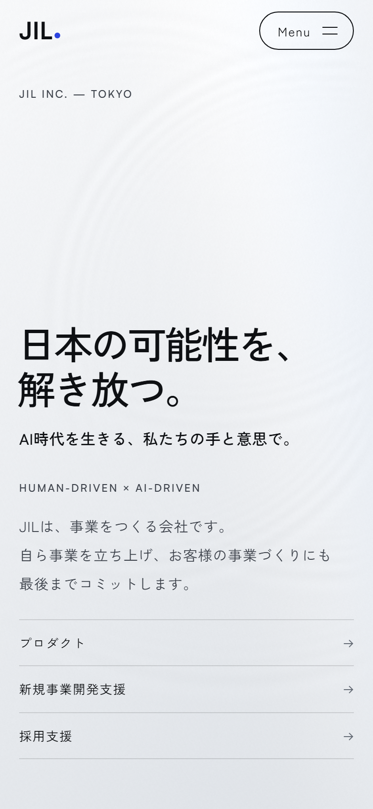
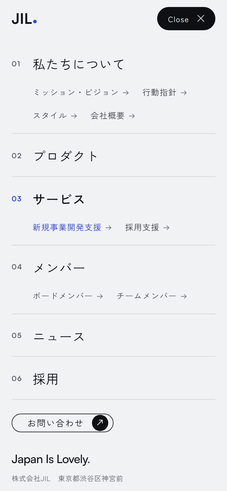
